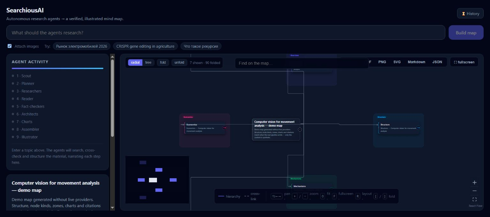
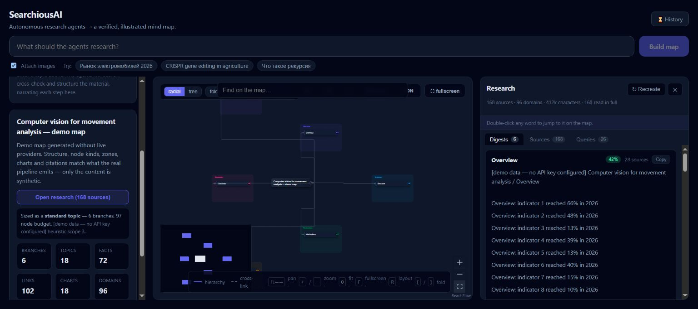
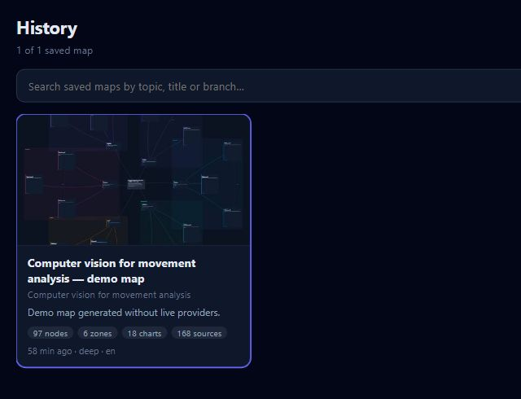

# SearchiousAI
### Research a subject as a map you can inspect.

A research application that turns a topic into a navigable hierarchy of branches, facts, cross-links, charts and sources. The system plans and gathers material before assembling the visual map, with the research record available beside the result.

*The working interface in explicitly labelled offline demo mode. All map content and source counts in this capture are synthetic fixtures.*

## A map needs a research plan

A list of search results does not explain how a subject is organized. Searchious begins with a scout stage that estimates the subject’s shape and scope. A planner then creates a topic-specific taxonomy and search plan. The selected ceiling limits work; it does not force a narrow question to consume the maximum possible number of nodes or sources.

Researchers work across branches, deduplicate queries and control source concentration. A reader retrieves full text, and digesters compress it into evidence the later stages can use. Gaps can trigger another research wave within the run’s budget.

## Watch the process, then explore the result

The activity panel exposes which stage is running instead of leaving the user with a spinner until the final graph appears. When the map is ready, branches can be folded, searched and explored in radial or tree layouts. Cross-links express relationships that do not fit neatly into a parent–child hierarchy.

The graph and research panel have complementary roles. The graph gives orientation; the panel exposes branch digests, source records and queries. The user can move from a compact node to the material behind it rather than receiving an attractive diagram whose origin is impossible to inspect.

*The research panel opens alongside the map. This screenshot demonstrates the UI contract with synthetic demo data, not verified claims about movement analysis.*

## Separate evidence, structure and illustration

~~~mermaid
flowchart LR
 A[Scout] --> B[Planner]
 B --> C[Parallel researchers]
 C --> D[Full-text reader]
 D --> E[Branch digesters]
 E --> F[Architects]
 E -. gaps within budget .-> C
 F --> G[Chart extraction]
 G --> H[Graph assembly and validation]
 H --> I[Optional illustrations]
 I --> J[Map and research panel]
~~~

Architects build branches from the digested material. The assembler joins them and validates references so that nodes, links and citations remain connected. Charts and illustrations are additional output stages; they should not substitute for the source-backed content structure.

The frontend uses **React, React Flow and Dagre**. The backend uses **FastAPI and LangGraph** to coordinate the workflow. Search, language-model and image providers can be configured independently. The local history is stored in the browser’s IndexedDB, including the research corpus needed to reopen a result.

## A result should be portable

The interface supports visual exports such as PDF, PNG and SVG, and structural exports such as Markdown and JSON. Those serve different uses: a diagram for a presentation, an outline for further writing, or the full data model for continued analysis. Folding a map affects readability without requiring the underlying research to be discarded.

*A saved demo map can be reopened from local history with its graph and research corpus. The counts describe the synthetic fixture.*

| Interaction | Purpose |
|---|---|
| Scope ceiling | Bound time, cost and graph size |
| Branch folding and search | Navigate a large result without displaying every node |
| Research panel | Inspect digests, source records and queries |
| Local history | Return to earlier work with its corpus |
| Structured export | Continue using the research outside the application |

## Evidence and limits

The screenshots were captured with all providers in stub mode, which the application labels explicitly. Their source counts, numerical facts, execution time and confidence values are fixtures and must not be used as research results or performance benchmarks. They show the implemented interaction and output structure without consuming paid provider calls.

Live-provider quality depends on source retrieval, extraction and factual verification. The application provides a workflow for inspecting evidence; it does not guarantee that every model-produced node is correct. The distinctive result is the connection between the research process, its retained material and the map a person actually navigates.

---

### Built by

[Shakhnazar Akhmer](https://github.com/Eye172).

[More projects](https://github.com/Eye172) · [Contact](mailto:shakh090909@gmail.com)

This repository presents the product and its engineering. Implementation and internal data are maintained separately. Screenshots and documented experiments are identified in their captions.
