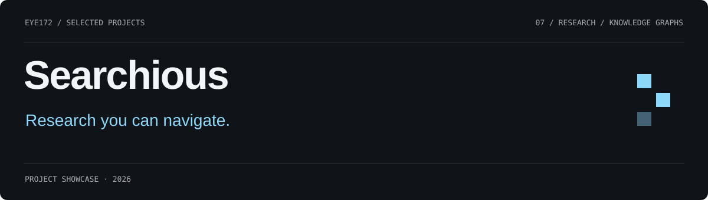
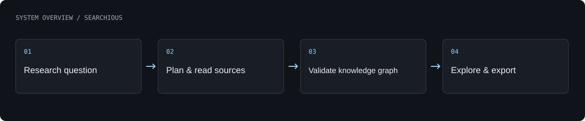

# Searchious

A research pipeline that turns a short question into an interactive map of topics, findings and supporting sources.

**Research and knowledge-map prototype**

[What is built](#what-is-built) · [Architecture](#architecture) · [Authors](#authors) · [Profile](https://github.com/Eye172)

## What is built

- Scope a research question and build a topic-specific research structure.
- Search and read sources, condense findings and replan as material appears.
- Stream progress into a navigable map with folding branches and reading panels.
- Validate graph references and export research outputs.

## Architecture

A staged research backend scopes and plans the work, retrieves information and assembles a graph. A browser interface presents incremental progress, map navigation and source-linked reading panels. Deterministic fixtures support development alongside external providers.

**Technology:** Python · FastAPI · LangGraph · React Flow · Graph layout tools.

## Current scope

A documented internal run produced 186 nodes from 245 sources across 153 domains. It is an example, not a guaranteed outcome. Some source matching is heuristic and requires reader review.

## Authors

[Shakhnazar Akhmer](https://github.com/Eye172).

## About this repository

This is a standalone project showcase containing a product description, visuals and a high-level architecture overview. Implementation source, model weights, credentials and internal project materials are not distributed here. No deployment is required to explore this page.

[Contact](mailto:shakh090909@gmail.com) · [GitHub profile](https://github.com/Eye172)
